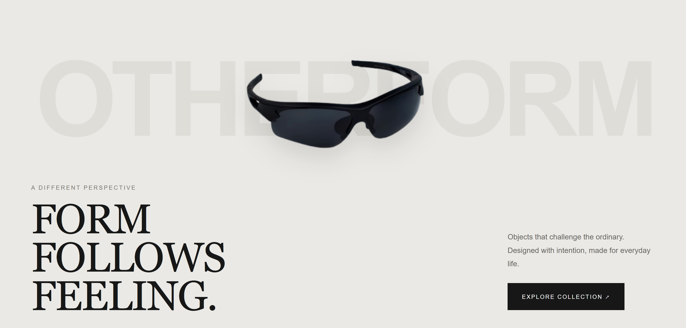
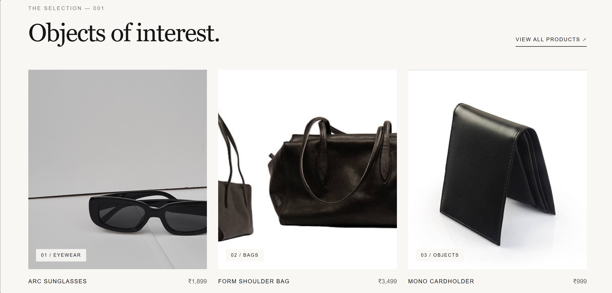
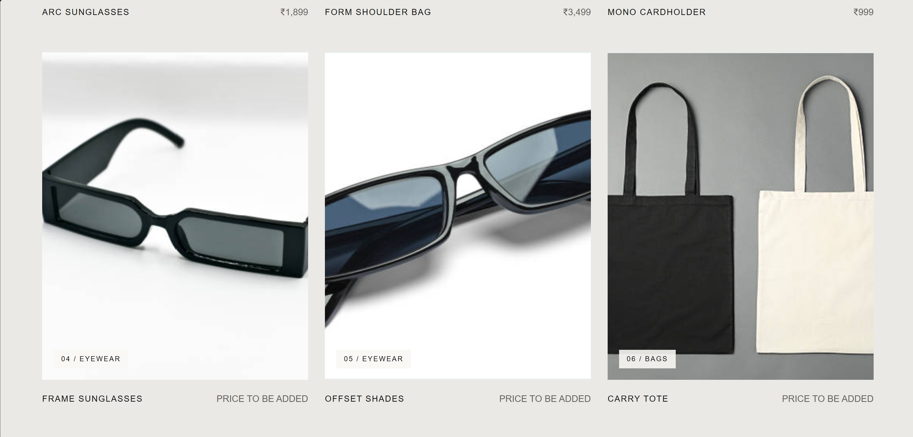
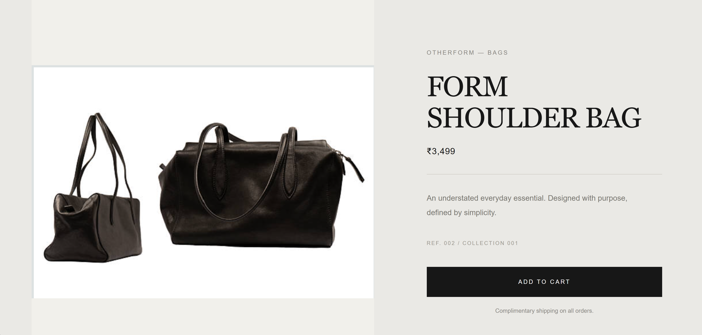
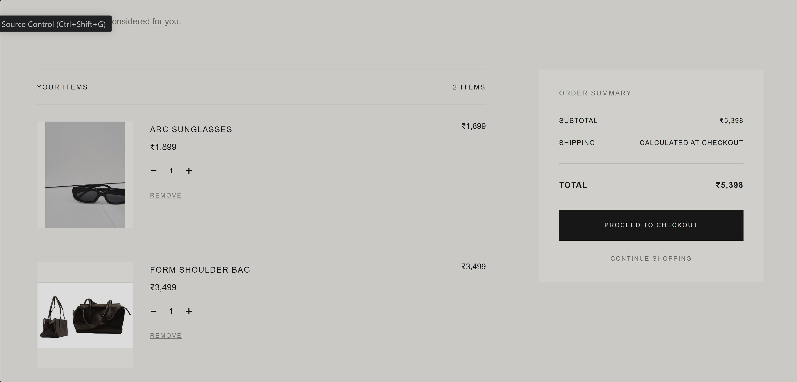
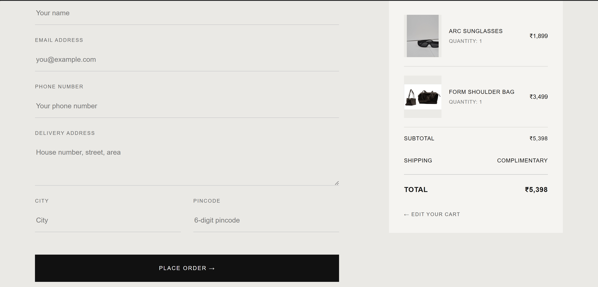

# OTHERFORM

### A Study in Form. An Expression of Function.

OTHERFORM is a minimalist e-commerce website prototype for a conceptual accessories brand. The website combines modern editorial design with a clean shopping experience, focusing on visual presentation, simplicity, and functionality.

## About the Project

The project was developed to explore the design and development of a frontend e-commerce website using fundamental web technologies.

The interface follows a modern, understated aesthetic, with emphasis on typography, product imagery, spacing, and visual hierarchy.

## Features

- **Homepage:** Brand introduction and featured product collection.
- **Shop:** Product catalogue displaying nine accessories.
- **Product Details:** Individual product pages with descriptions, images, and pricing.
- **Shopping Cart:** Add products, update quantities, and remove items.
- **Checkout:** Customer information form and order summary.
- **Order Confirmation:** Simulated order confirmation after form submission.
- **Cart Persistence:** Uses browser localStorage to retain cart contents between page visits.
- **Responsive Design:** Layout adapts to different screen sizes.

## Technologies Used

- HTML5 — Website structure
- CSS3 — Styling, layout, and responsive design
- JavaScript — Interactive functionality and cart management
- Git & GitHub — Version control and project hosting

## Project Structure

```text
OTHERFORM/
│
├── index.html
├── shop.html
├── product.html
├── cart.html
├── checkout.html
│
├── css/
│   └── style.css
│
├── js/
│
└── assets/
    └── images/
```

## How to Run

1. Clone or download this repository.
2. Open the project folder in Visual Studio Code.
3. Open `index.html` using a local development server, such as the VS Code Live Server extension.
4. Explore the website through your browser.

## Important Note

OTHERFORM is a frontend-only prototype developed for educational purposes.

The checkout process simulates order placement. No actual payments are processed, and customer information is not transmitted to a server. Shopping cart data is stored locally in the browser using localStorage.

## Future Improvements

- Backend integration and database connectivity.
- Secure user authentication.
- Functional payment gateway integration.
- Persistent order management.
- Improved product filtering and search functionality.

## Screenshots

### Homepage




### Shop


### Product Details


### Shopping Cart


### Checkout


---

**OTHERFORM** — Designed to be different.